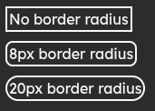
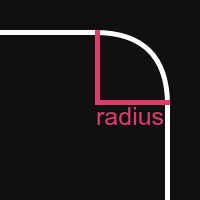

# Border Radius

Defines the corner rounding on an element.

```css
border-radius: <size>;
border-radius: 8px;
```




## Syntax

`border-radius: <size>;`

Value must be of type [\<size>](../data-types/size.md).

## Support


