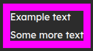

# Border Size

Defines the width of the border on an element.

```css
border-size: <size>;
border-size: 12px;
```



## Syntax

`border-size: <size>;`

Value must be of type [\<size>](../data-types/size.md).

## Support


