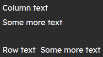

# Direction

Defines the direction of elemnts inside, defaults to column.

```css
direction: <direction>;
direction: row;
```



## Syntax

`direction: <direction>;`

Value must be one of row, column.

## Support


